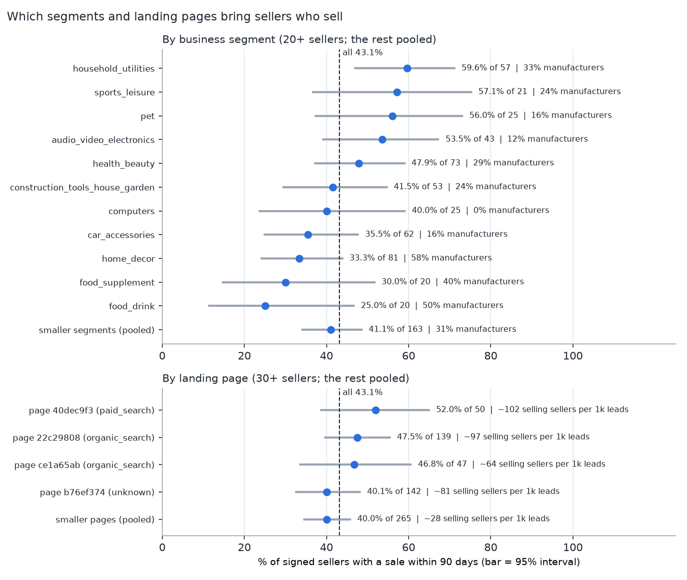
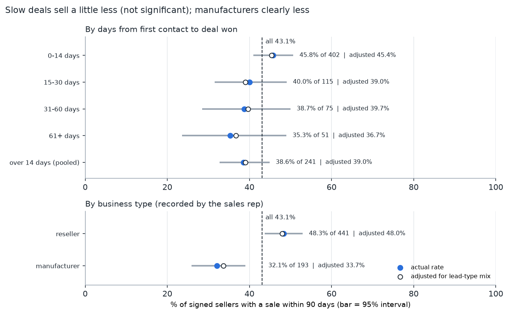

# Marketing Lead Funnel Analysis (DuckDB + SQL)

> **Status: complete.** Three parts: conversion by month, channel and speed and the May 2018 drop (Part 1), sales capacity, landing pages and the profile of won deals (Part 2), and whether signed sellers actually start selling (Part 3). 19 commented SQL queries, 11 charts and 25 offline tests. [Recommendations](#recommendations) and [limitations](#limitations) are at the end.

**Business question:** a marketplace recruits sellers through a marketing and sales funnel: a business signs up on a landing page, a sales development rep (SDR) qualifies it, and a sales rep (SR) tries to close it. **Which marketing channels bring leads that actually sign, how fast do deals close, and why did conversion fall in May 2018?** The answers decide where marketing spends its budget and how sales should prioritise its follow-up.

## TL;DR
- **About 1 in 20 leads becomes a seller who actually sells.** 11.3% of the Jan–May 2018 leads signed within 90 days, and only 43.1% of signed sellers made a sale within 90 days of signing. Chained together, that is roughly 49 selling sellers per 1,000 leads (an estimate: the two rates come from overlapping, not identical, groups). The biggest leak is after the deal, not before it.
- **Channels differ more in quality than in volume.** Social and email are 23.3% of leads but 9.9% of wins. Paid and organic search sign leads at the same rate, but paid-search sellers start selling more often (55.0% vs 39.1%): about 68 vs 48 selling sellers per 1,000 leads. A quarter of wins (24.9%) have no channel, and most of those came through one landing page.
- **Landing pages matter even within a channel.** Three pages took 29.6% of leads and 53.0% of wins. Within organic search one page converts 22.0% against 4.7–7.0% on two others, and its sellers still start selling at 47.5%.
- **May 2018's fall (12.1% → 8.4%) was weaker conversion, not worse leads.** 3.34 of the 3.75 points came from conversion within channels, mid-sized online sellers account for 72% of it, and the number of reps with a win dipped only slightly (15 against 16–20).
- **Manufacturers, offline and industry businesses sign but rarely sell.** 32.1% of manufacturers start selling within 90 days against 48.3% of resellers (the gap holds after adjusting for lead type); offline 23.8% and industry 35.6% against 63.2% for big online sellers.

<details>
<summary><b>All headline findings</b> (details and charts in <a href="#findings">Findings</a>)</summary>

- **About 1 in 9 leads signs within 90 days.** 678 of the 5,998 leads from Jan–May 2018 (11.3%) became sellers within 90 days. Jan–Apr was steady at 11.3–12.6%, then May fell to **8.4%**.
- **Social and email bring volume, not sellers.** Together they are 23.3% of leads but only 9.9% of 90-day wins: social converts at 5.2% and email at 3.5%, against 12.3–12.9% for organic search, paid search and direct traffic.
- **A quarter of wins can't be credited to any channel.** Leads with origin `unknown` or missing are 14.4% of leads but 24.9% of wins, and they convert best (19.6%). Any cost-per-seller figure by channel built on this data leaves out a quarter of signed sellers.
- **Deals close fast or not at all.** 38.1% of wins sign within a week and 57.3% within two weeks; only 8.7% come after day 90.
- **May's drop was a conversion problem, not a lead-mix problem.** Of the 3.75-point fall, the channel mix explains −0.41 points and weaker conversion *within* channels −3.34 points (89%). Every large channel fell, e.g. paid search 13.4% → 9.0%.
- **Fewer reps is a weak explanation.** 15 reps closed a deal from the May cohort, the fewest of any cohort (16–20 in January–April), but wins per rep (8.7) were in line with February and March (8.3–8.4).
- **Wins lean on a few reps.** The top 5 of 21 reps won 51% of 2018 wins, and the top rep won 16%.
- **Three landing pages bring over half the sellers.** They took 29.6% of leads but 53.0% of 90-day wins, each converting at about 20%. Within organic search alone, the best page converts at 22.0% and the weakest at 4.7%.
- **The "unknown" channel is mostly one page.** 536 of the 813 unknown-origin leads, and 119 of their 157 wins, came in through page `b76ef374`, which gives marketing ops a concrete place to start fixing the tracking.
- **May's missing sellers were mostly mid-sized online sellers.** 90-day wins per 1,000 leads fell from 121.2 to 83.7; `online_medium` sellers account for 27.0 of that 37.5 drop (72%). Splitting the drop by landing page instead of channel gives the same answer: the page mix explains only −0.40 points.
- **Signing isn't selling: 43.1% of signed sellers made a sale within 90 days.** Of 643 sellers signed from December 2017 to May 2018, only 16.8% sold within 30 days, and 48.4% had no sale at all in the order data by 2018-08-21. The median first sale came 39 days after the deal.
- **Paid search overtakes organic search after the deal.** Both channels sign 12.3–12.4% of their leads, but 55.0% of paid-search sellers start selling within 90 days against 39.1% for organic search. That is about 68 vs 48 selling sellers per 1,000 leads.
- **Big online sellers start selling; offline businesses mostly don't.** 63.2% of `online_big` sellers made a sale within 90 days (active sellers' median: R$821), against 23.8% of `offline` and 35.6% of `industry` sellers.
- **Manufacturers sign but don't sell.** 32.1% of manufacturers made a sale within 90 days against 48.3% of resellers, and the gap stays (33.7% vs 48.0%) after adjusting for lead type. They are 30.0% of signed sellers but 9.7% of the 90-day sales value.
- **The best landing pages keep their lead after the deal.** Pages `40dec9f3` and `22c29808` sign about 20% of their leads and their sellers start selling at 52.0% and 47.5%, so they bring ~102 and ~97 selling sellers per 1,000 leads, against ~28 for the long tail of small pages.
- **Fast deals look a little better, but it isn't proven.** 45.8% of deals closed within 14 days start selling vs 38.6% of slower ones; the gap survives a lead-type adjustment (45.4% vs 39.0%) but isn't significant at the 5% level (z = −1.78).

</details>

## Data
[Marketing Funnel by Olist](https://www.kaggle.com/datasets/olistbr/marketing-funnel-olist): real, anonymised data on 8,000 marketing-qualified leads (MQLs) who asked to sell on the Olist marketplace between June 2017 and June 2018, randomly sampled by Olist from all its MQLs, plus the 842 of them that signed. Kaggle needs a login, so `scripts/download_data.py` fetches the two CSVs (~0.9 MB) from public GitHub mirrors ([`mara/mara-olist-ecommerce-data`](https://github.com/mara/mara-olist-ecommerce-data), with [`patterns-app/public_data`](https://github.com/patterns-app/public_data) as a fallback). Both mirrors serve byte-identical files whose total size matches the Kaggle listing exactly. The script pins their SHA-256 hashes and stops if a file changes. The raw CSVs aren't committed.

**Licence:** the dataset is © Olist and published under [CC BY-NC-SA 4.0](https://creativecommons.org/licenses/by-nc-sa/4.0/) (see the [Kaggle page](https://www.kaggle.com/datasets/olistbr/marketing-funnel-olist)). This repo uses it for non-commercial analysis and publishes only derived aggregates.

| Table | Rows | What it holds |
|---|---:|---|
| `mqls` | 8,000 | lead id, first contact date (2017-06-14 to 2018-05-31), landing page, origin (channel) |
| `closed_deals` | 842 | won date (2017-12-05 to 2018-11-14), seller id, SDR, SR, business segment, lead type, self-declared profile |
| `orders` (Part 3) | 99,441 | order id, status, purchase time (2016-09-04 to 2018-10-17) |
| `order_items` (Part 3) | 112,650 | order id, seller id, item price |

**Part 3: what signed sellers sold.** The won deals join to Olist's [Brazilian E-Commerce Public Dataset](https://www.kaggle.com/datasets/olistbr/brazilian-ecommerce) by `seller_id` (© Olist, also CC BY-NC-SA 4.0). The download script takes only the orders and order items (~33 MB), from Olist's own GitHub repo ([`olist/work-at-olist-data`](https://github.com/olist/work-at-olist-data)) with the mara mirror as fallback. The two copies have the same rows but aren't byte-identical: the mara copy quotes every field, and 67 order lines have a different `freight_value`. The analysis doesn't use freight, so each source has its own pinned hash. 380 of the 842 signed sellers appear in the orders, and none has an order dated before it signed.

**Selling window.** The order data has 176–372 orders a day in the four weeks to 2018-08-21; from 2018-08-22 it falls almost every day (187, 144, 99 … 14 orders on 2018-08-29), so the snapshot was taken while recent orders were still coming in. Orders from 2018-08-22 on are ignored. Each seller is followed for 90 days after signing, so Part 3 uses the **643 sellers signed from 2017-12-05 to 2018-05-23**. A *sale* is an order that wasn't cancelled or unavailable; *sales value* is the item price without freight.

**Analysis window: leads first contacted in Jan–May 2018 (5,998 leads).** The deal records start on 2017-12-05, so a 2017 lead that signed before then simply isn't in the data. The June–October 2017 cohorts show no win within 90 days at all, which is a recording gap, not a sales result. Every 2018 cohort is observed for at least 167 days, so a 90-day conversion window is complete for all of them.

## Approach
1. **Download** (`scripts/download_data.py`): two sources per file, SHA-256 checked.
2. **Load** (`pipeline/build_db.py`): typed DuckDB tables plus a `leads` view (cohort month, days to close, a 90-day win flag, the analysis-window flag). Part 3 adds the `orders` and `order_items` tables and a `signed_sellers` view (one row per won deal: first sale, orders and sales value in the 90 days after signing). Data-quality checks run on load and the build stops if one fails: unique lead ids, unique sellers, no deal without a lead, no wins before deal tracking started, unique order lines, no order line without an order, and no signed seller with an order before it signed. Reported, not dropped: 1 deal dated 2 days before its first contact, 60 leads with no origin, and only 45 of 842 deals with a declared monthly revenue above 0 (so revenue can't be analysed from this field).
3. **Query** ([`sql/`](sql/)): each file answers one business question and is commented.
4. **Report** (`report/build.py`): runs every query and writes [`results/REPORT.md`](results/REPORT.md), CSVs and charts.

## Findings

### 1. About 1 in 9 leads signs within 90 days, and May 2018 dropped


| First contact | Leads | Signed ≤ 90 days | % | Signed by Nov 2018 | % |
|---|---:|---:|---:|---:|---:|
| 2018-01 | 1,141 | 129 | 11.3 | 152 | 13.3 |
| 2018-02 | 1,028 | 128 | 12.5 | 149 | 14.5 |
| 2018-03 | 1,174 | 141 | 12.0 | 167 | 14.2 |
| 2018-04 | 1,352 | 171 | 12.6 | 183 | 13.5 |
| 2018-05 | 1,303 | 109 | **8.4** | 130 | 10.0 |
| **Jan–May** | **5,998** | **678** | **11.3** | **781** | **13.0** |

Lead volume ran at 1,000–1,350 a month while conversion held at 11–13% until May. Query: [`01_cohort_conversion.sql`](sql/01_cohort_conversion.sql).

### 2. Social and email fill the top of the funnel but rarely sign


| Channel | Leads | % of leads | Wins ≤ 90 d | % of wins | Conversion | 95% interval |
|---|---:|---:|---:|---:|---:|---|
| organic_search | 1,736 | 28.9 | 213 | 31.4 | 12.3% | 10.8–13.9 |
| paid_search | 1,182 | 19.7 | 147 | 21.7 | 12.4% | 10.7–14.4 |
| social | 1,051 | 17.5 | 55 | 8.1 | **5.2%** | 4.0–6.7 |
| unknown | 813 | 13.6 | 157 | 23.2 | **19.3%** | 16.7–22.2 |
| direct_traffic | 380 | 6.3 | 49 | 7.2 | 12.9% | 9.9–16.6 |
| email | 347 | 5.8 | 12 | 1.8 | **3.5%** | 2.0–5.9 |
| referral | 211 | 3.5 | 21 | 3.1 | 10.0% | 6.6–14.7 |
| other, display, other_publicities, (missing) | 278 | 4.6 | 24 | 3.5 | 8.6% | small groups, see [`REPORT.md`](results/REPORT.md) |

- **Social and email** are 1,398 leads (23.3%) but 67 wins (9.9%). Their intervals don't overlap with the search channels', so the gap isn't noise. Each of their leads still costs SDR time to qualify.
- **Paid and organic search convert the same** (12.4% vs 12.3%), so paid search buys extra volume at the same quality rather than better leads.
- **Unattributed leads convert best.** `unknown` (813) and missing origin (48) together are 861 leads (14.4%) with 169 wins (24.9%), a 19.6% rate. The data can't say where they came from. One plausible reading is that they include routes that aren't tagged, such as partner or sales-sourced contacts, but that is a hypothesis to check with the marketing team, not a finding.

Query: [`02_channel_conversion.sql`](sql/02_channel_conversion.sql) (Wilson 95% intervals, computed in SQL).

### 3. Deals close in the first two weeks or drift


Of the 743 wins that closed within 167 days (the follow-up every 2018 cohort gets), **38.1% signed within 7 days, 57.3% within 14, 74.3% within 30 and 91.3% within 90**. Among 90-day wins, the median time to close is 8–10 days for search and direct leads but 18 days for social. Query: [`03_time_to_close.sql`](sql/03_time_to_close.sql).

### 4. May's drop: weaker conversion within channels, not a worse mix


A shift-share split of the change from Jan–Apr (12.1%) to May (8.4%):

| Effect | Points | What it means |
|---|---:|---|
| Channel mix | −0.41 | May had more social and email leads (social 16.7% → 20.6% of leads) |
| Within-channel conversion | **−3.34** | the same channels converted worse |

| Channel | Jan–Apr conversion | May conversion |
|---|---:|---:|
| organic_search | 12.9% | 9.6% |
| paid_search | 13.4% | 9.0% |
| social | 6.0% | 3.0% |
| unknown | 19.9% | 16.9% |
| direct_traffic | 14.2% | 7.7% |

Because nearly every channel fell together, the cause is more likely on the sales side (capacity, follow-up, or a change in process) than in marketing targeting. Section 5 checks rep capacity to test this. Query: [`04_may_drop_mix_vs_rate.sql`](sql/04_may_drop_mix_vs_rate.sql).

### 5. Sales capacity: May had slightly fewer reps, and wins lean on a few people


| Lead cohort | Leads | Wins | Reps with a win (SDR / SR) | Wins per SR | Median days to close |
|---|---:|---:|---:|---:|---:|
| 2018-01 | 1,141 | 152 | 12 / 16 | 9.5 | 17.5 |
| 2018-02 | 1,028 | 149 | 17 / 18 | 8.3 | 16.0 |
| 2018-03 | 1,174 | 167 | 17 / 20 | 8.4 | 12.0 |
| 2018-04 | 1,352 | 183 | 13 / 16 | 11.4 | 9.0 |
| 2018-05 | 1,303 | 130 | 15 / 15 | 8.7 | 10.0 |

- **May had the fewest reps, but only by a little.** 15 reps closed a May-cohort deal, against 16–20 in January–April. Wins per rep (8.7) matched February and March (8.3 and 8.4), and April (11.4) was the outlier. A headcount dip of one to five people doesn't explain a fall of 3.75 points on its own.
- **Deals that did sign closed no slower.** The median days to close for May's wins is 10, against 16–18 for January and February.
- **Wins are concentrated.** 21 reps won at least one deal in the window. The top rep won 128 of 781 (16.4%), the top 5 won 50.6%, and the top 10 won 81.0%. Losing one of the top reps would be a material capacity hit.

**What this can't show.** Reps are recorded only on won deals, so a rep with no win from a cohort is invisible, and the counts are a lower bound. Leads per rep aren't in the data, so workload can't be measured directly; "wins per rep" is a proxy, not a win rate. Queries: [`05_sales_capacity.sql`](sql/05_sales_capacity.sql), [`06_rep_concentration.sql`](sql/06_rep_concentration.sql).

### 6. Landing pages: three pages bring half the sellers, and pages differ within a channel
The 5,998 leads arrived through 407 landing pages. 18 pages have 50+ leads; the other 389 pages share 31.6% of leads and convert at 8.2%.

| Page | Leads | % of wins | Conversion | 95% interval | Main channel (share of the page's leads) |
|---|---:|---:|---:|---|---|
| b76ef374 | 751 | 22.4 | 20.2% | 17.5–23.3 | unknown (71.4%) |
| 22c29808 | 726 | 22.0 | 20.5% | 17.7–23.6 | organic_search (56.9%) |
| 58326e62 | 495 | 3.2 | **4.4%** | 3.0–6.6 | social (93.7%), live from March |
| ce1a65ab | 346 | 6.9 | 13.6% | 10.4–17.6 | organic_search (59.8%) |
| 88740e65 | 306 | 3.1 | 6.9% | 4.5–10.3 | social (93.1%), January–March only |
| 40dec9f3 | 297 | 8.6 | 19.5% | 15.4–24.4 | paid_search (73.1%) |
| f017be4d | 224 | 2.4 | 7.1% | 4.4–11.3 | organic_search (63.8%) |
| e492ee5e | 214 | 1.2 | 3.7% | 1.9–7.2 | organic_search (39.7%) |

Pages are ids only (the data is anonymised), so we can't see what is on them. The top three pages (`b76ef374`, `22c29808`, `40dec9f3`) took 29.6% of leads and **53.0% of 90-day wins**.

Many pages serve mostly one channel, so a page's rate partly reflects its channel. Comparing pages **inside the same channel** removes that:


- **Organic search: 22.0% on one page, 4.7–7.0% on two others.** Page `22c29808` converts 22.0% of its 413 organic-search leads (18.3–26.3); `f017be4d` converts 7.0% (3.8–12.4) and `e492ee5e` 4.7% (1.8–11.5). The intervals don't overlap, so the gap isn't noise. The channel as a whole converts at 12.3%.
- **Paid search: `40dec9f3` converts 19.4%** of its 217 paid leads (14.6–25.1), against 12.4% for the channel.
- **Social: the page changed in March.** Page `88740e65` ran January–March at 7.0% of its social leads; `58326e62` took over from March at 4.1%. The intervals overlap (4.6–10.6 vs 2.6–6.3), so this sample can't show that the new page is worse, but it is the first thing to check for social.
- **Unknown origin is concentrated on one page.** `b76ef374` holds 536 of the 813 unknown-origin leads (65.9%) and 119 of their 157 wins, converting at 22.2%. Whatever route feeds this page is missing its tracking tag.

A page id can stand for a campaign or a target audience rather than a design, so these gaps are a reason to A/B test the weaker pages against the strong ones, not proof that the page layout causes them. Queries: [`07_landing_pages.sql`](sql/07_landing_pages.sql), [`08_pages_within_channel.sql`](sql/08_pages_within_channel.sql).

### 7. May's drop by page and by type of seller
**By page, the answer doesn't change.** Repeating Part 1's shift-share split with landing pages as the groups gives a page-mix effect of −0.40 points and a within-page effect of −3.35 points (channels: −0.41 / −3.34). The social page switch moved May's leads onto a weaker page (−0.74 points), partly offset by the old social page dropping out (+0.34) and smaller shifts elsewhere. About half the within-page fall (−1.66 points) is in the long tail of small pages, which fell from 9.4% to 4.5%; the two biggest pages also fell (`22c29808` 21.6% → 16.8%, `b76ef374` 20.8% → 17.8%). Query: [`09_may_drop_by_page.sql`](sql/09_may_drop_by_page.sql).

**By lead type, the drop is concentrated.** The sales rep records a lead type only when a deal is won, so a conversion rate per type can't be computed. Instead, each type's 90-day wins are scaled to all leads in the period; these add up to the overall rate.


| Lead type | 90-day wins (Jan–May) | Wins per 1,000 leads, Jan–Apr | May | Change | Share of the drop |
|---|---:|---:|---:|---:|---:|
| online_medium | 274 | 51.5 | 24.6 | **−27.0** | **71.9%** |
| online_big | 100 | 17.9 | 12.3 | −5.6 | 14.9% |
| online_small | 57 | 10.4 | 6.1 | −4.3 | 11.4% |
| offline | 85 | 14.7 | 12.3 | −2.4 | 6.4% |
| industry | 102 | 17.5 | 15.3 | −2.1 | 5.6% |
| online_beginner | 42 | 6.4 | 9.2 | +2.8 | −7.5% |
| online_top | 13 | 1.9 | 3.1 | +1.2 | −3.1% |
| **All** | **678** | **121.2** | **83.7** | **−37.5** | **100%** |

(5 wins with no lead type are left out of the rows but included in the total.) Mid-sized online sellers are the biggest group of wins (40.4%), and in May they signed at under half the earlier rate (32 wins against an average of 60.5 a month in January–April). The other groups changed by a few wins each. So May's problem was mostly with one kind of prospect, the established mid-sized online seller. Query: [`10_may_drop_by_lead_type.sql`](sql/10_may_drop_by_lead_type.sql).

### 8. What the funnel signs: business segments of won deals
Of the 781 sellers signed from the 2018 cohorts, the top 6 of 33 segments make up 56.2%: home décor (12.3%), health & beauty (11.4%), car accessories (9.0%), construction tools / house & garden (7.9%), household utilities (7.9%) and audio/video electronics (7.7%). 28.6% of all signed sellers are manufacturers and the rest resellers, but this varies a lot by segment: 55.2% in home décor against 14.3% in car accessories, 8.3% in audio/video and none of 31 in computers. 54.5% of these wins closed within 14 days; audio/video closed slower (43.3% within 14 days, 60 wins). Segment counts are small, so these are a profile for Part 3 rather than findings to act on alone. Query: [`11_won_segments.sql`](sql/11_won_segments.sql).

### 9. After the deal: fewer than half of signed sellers start selling


Of the 643 sellers signed from December 2017 to May 2018:

| Milestone after the deal | Sellers | % of signed sellers |
|---|---:|---:|
| first sale within 7 days | 13 | 2.0 |
| within 14 days | 41 | 6.4 |
| within 30 days | 108 | 16.8 |
| within 60 days | 204 | 31.7 |
| within 90 days | 277 | **43.1** |
| first sale after day 90 (before 2018-08-22) | 55 | 8.6 |
| no sale in the order data | 311 | **48.4** |

- **Getting to the first sale is slow.** Among sellers who sold within 90 days, the median first sale came 39 days after the deal. Deals close fast (Part 1: most within two weeks), but revenue starts about five weeks later.
- **Nearly half never show a sale.** 311 sellers (48.4%) had no order by 2018-08-21, even though each had at least 90 days. Some may sell in orders missing from the public data (see Limitations), so treat 43.1% as a lower bound, but a gap this large is worth checking against Olist's internal seller data.
- **By month signed**, 38.9–51.0% sold within 90 days (May: 51.0% of 100). The 90-day sales value of the 277 active sellers was R$328,038, with a median of R$324 per active seller. One seller made 23.1% of it, and 56.4% of February's, so sales-value totals swing with single accounts; the activation rate is the steadier measure.

Queries: [`12_seller_activation.sql`](sql/12_seller_activation.sql), [`13_time_to_first_sale.sql`](sql/13_time_to_first_sale.sql).

### 10. Which channels and kinds of seller start selling


| Channel | Signed sellers | Sold ≤ 90 days | 95% interval | Lead → deal (Part 1) | Selling sellers per 1,000 leads | Share of 90-day sales value |
|---|---:|---:|---|---:|---:|---:|
| organic_search | 202 | 39.1% | 32.6–46.0 | 12.3% | 48.0 | 27.3% |
| unknown | 147 | 40.1% | 32.6–48.2 | 19.3% | **77.5** | 38.1% |
| paid_search | 140 | **55.0%** | 46.7–63.0 | 12.4% | **68.4** | 22.6% |
| social | 54 | 42.6% | 30.3–55.8 | 5.2% | 22.3 | 3.9% |
| direct_traffic | 49 | 44.9% | 31.9–58.7 | 12.9% | 57.9 | 2.7% |
| smaller channels (pooled) | 51 | 33.3% | 22.0–47.0 | 6.8% | 22.7 | 5.3% |

"Selling sellers per 1,000 leads" multiplies the channel's lead-to-deal rate (Part 1, 2018 cohorts) by its activation rate. The two rates come from overlapping but not identical groups, so it's an estimate.

- **Paid search beats organic search once selling is counted.** The two channels sign leads at the same rate, but paid-search sellers start selling more often (55.0% vs 39.1%; the intervals only just don't overlap: organic up to 46.0%, paid from 46.7%). Per 1,000 leads that's about 68 selling sellers vs 48.
- **Social's problem is the lead step, not the sellers.** Social sellers who sign start selling at about the average rate (42.6%, interval 30.3–55.8), so social stays near the bottom (~22 per 1,000 leads) mainly because few of its leads sign.
- **Unknown-origin leads stay the most valuable** (~78 selling sellers per 1,000 leads) and carry 38.1% of the 90-day sales value, though one seller makes 60.5% of that channel's total. This makes the tracking fix (recommendation 3) more urgent.

| Lead type | Signed sellers | Sold ≤ 90 days | 95% interval | Active sellers' median sales | Share of 90-day sales value |
|---|---:|---:|---|---:|---:|
| online_medium | 263 | 46.4% | 40.5–52.4 | R$260 | 26.9% |
| online_big | 95 | **63.2%** | 53.1–72.2 | **R$821** | **46.9%** |
| industry | 90 | 35.6% | 26.4–45.9 | R$189 | 4.9% |
| offline | 80 | **23.8%** | 15.8–34.1 | R$190 | 2.2% |
| online_small | 62 | 38.7% | 27.6–51.2 | R$295 | 6.3% |
| online_beginner | 37 | 32.4% | 19.6–48.5 | R$409 | 3.2% |
| other types (pooled) | 16 | 50.0% | 28.0–72.0 | R$323 | 9.6% |

- **`online_big` sellers are 14.8% of signed sellers but 46.9% of the 90-day sales value.** They are the most likely to start selling (63.2%), and an active one sells a median of R$821 in 90 days, about 3× an `online_medium` seller. One of them makes 49.2% of the group's total, but the activation rate and median barely depend on it.
- **Offline and industry sellers sign but rarely start selling.** Only 23.8% of `offline` and 35.6% of `industry` sellers made a sale within 90 days; their intervals sit below `online_big`'s. One plausible reason is that businesses without an online shop need more help to list products, an onboarding cost the deal doesn't show; that is a hypothesis to check with the onboarding team.
- **May's missing sellers were average sellers.** `online_medium`, the type behind most of May's drop (section 7), starts selling at 46.4%, close to the 43.1% average.

Queries: [`14_activation_by_channel.sql`](sql/14_activation_by_channel.sql), [`15_activation_by_lead_type.sql`](sql/15_activation_by_lead_type.sql).

### 11. Segments, business type, landing pages and close speed after the deal


Same 643 sellers and 90-day definition as sections 9–10. Segments with fewer than 20 signed sellers and pages with fewer than 30 are pooled.

| Segment | Signed sellers | Sold ≤ 90 days | 95% interval | Manufacturers |
|---|---:|---:|---|---:|
| household_utilities | 57 | **59.6%** | 46.7–71.4 | 33.3% |
| health_beauty | 73 | 47.9% | 36.9–59.2 | 28.8% |
| construction_tools_house_garden | 53 | 41.5% | 29.3–54.9 | 24.5% |
| car_accessories | 62 | 35.5% | 24.7–47.9 | 16.1% |
| home_decor | 81 | **33.3%** | 24.0–44.1 | **58.0%** |
| 6 more segments with 20–43 sellers | 154 | 25.0–57.1% | see chart | 0–50% |
| smaller segments (20, pooled) | 163 | 41.1% | 33.8–48.8 | 31.3% |

- **Home décor is the biggest segment and one of the weakest after the deal.** It is 12.6% of signed sellers, but only 33.3% start selling within 90 days, against 59.6% in household utilities (the two intervals don't overlap). 7 of the 11 listed segments sit between 35.5% and 57.1% with wide intervals, so the other gaps aren't findings on their own. With 11 segments compared, one clear gap can partly be chance; treat it as a lead to check, not a verdict.
- **Home décor's weakness is partly its manufacturers.** 58.0% of its sellers are manufacturers, the highest share of any listed segment, and manufacturers start selling less often than resellers, even within the same lead type (below).
- **Sales value by segment is dominated by single accounts.** The pooled small segments carry 48.3% of the 90-day sales value, but one watches seller makes 47.8% of that. Segment shares of sales value aren't a reliable guide here.

| Landing page (main channel) | Signed sellers | Sold ≤ 90 days | 95% interval | Lead → deal (2018) | Selling sellers per 1,000 leads |
|---|---:|---:|---|---:|---:|
| `b76ef374` (unknown) | 142 | 40.1% | 32.4–48.4 | 20.2% | 81.2 |
| `22c29808` (organic search) | 139 | 47.5% | 39.4–55.7 | 20.5% | 97.4 |
| `40dec9f3` (paid search) | 50 | **52.0%** | 38.5–65.2 | 19.5% | **101.5** |
| `ce1a65ab` (organic search) | 47 | 46.8% | 33.3–60.8 | 13.6% | 63.6 |
| 104 smaller pages (pooled) | 265 | 40.0% | 34.3–46.0 | 7.0% | 28.1 |

- **The strong pages don't trade signatures for inactive sellers.** Sellers from the three ~20% pages start selling at 40.1–52.0%, around or above the 43.1% average, and the activation intervals of all four big pages overlap. So the lead step decides the page ranking: the best pages bring about 3–4× as many selling sellers per 1,000 leads as the small-page tail (81–102 vs 28). The A/B test in recommendation 5 stays worthwhile once selling is counted.



| Group | Signed sellers | Sold ≤ 90 days | 95% interval | Adjusted for lead type | z vs 0–14 days |
|---|---:|---:|---|---:|---:|
| closed in 0–14 days | 402 | 45.8% | 41.0–50.7 | 45.4% | – |
| 15–30 days | 115 | 40.0% | 31.5–49.1 | 39.0% | −1.10 |
| 31–60 days | 75 | 38.7% | 28.5–50.0 | 39.7% | −1.14 |
| 61+ days | 51 | 35.3% | 23.6–49.0 | 36.7% | −1.42 |
| over 14 days (pooled) | 241 | 38.6% | 32.7–44.9 | 39.0% | −1.78 |
| reseller | 441 | 48.3% | 43.7–53.0 | 48.0% | |
| manufacturer | 193 | **32.1%** | 25.9–39.0 | **33.7%** | |

"Adjusted for lead type" is each group's rate within every lead type, weighted by how common that lead type is among all 643 sellers, so a gap isn't just one group having more offline or industry sellers.

- **Manufacturers start selling much less often than resellers.** 32.1% of them start selling within 90 days against 48.3% of resellers; the intervals don't overlap, and adjusting for lead type barely changes it (33.7% vs 48.0%). Active manufacturers also sell less (median R$260 vs R$390 in 90 days). They are 30.0% of signed sellers but 9.7% of the 90-day sales value. A plausible reason is that a manufacturer must build a catalogue (photos, listings, prices for marketplace channels) that a reseller often already has, but the data can't confirm that.
- **Slow deals sell a little less, but the evidence is weak.** The 0–14-day group starts selling at 45.8% and each slower group a bit less (40.0%, 38.7%, 35.3%); the gap holds after the lead-type adjustment (45.4% vs 39.0% for all slower deals), but no z statistic reaches 1.96, so it isn't significant at the 5% level. The time from deal to first sale is about the same (median 37–39 days) except for 61+ day deals (48 days, 18 active sellers). It's a reason not to over-invest in very long deal cycles, not proof that slow deals make bad sellers.

Queries: [`16_activation_by_segment.sql`](sql/16_activation_by_segment.sql), [`17_activation_by_business_type.sql`](sql/17_activation_by_business_type.sql), [`18_activation_by_page.sql`](sql/18_activation_by_page.sql), [`19_close_speed_vs_activation.sql`](sql/19_close_speed_vs_activation.sql).

## Recommendations
Ranked by how many selling sellers each could add and how firm the evidence is. Each is tied to a figure above (§ = section of [Findings](#findings)). Owners are roles: the data has no organisation chart.

| # | Recommendation | Why (measured) | Owner |
|---|---|---|---|
| 1 | **Measure the funnel to the first sale, not the signature.** Add "first sale within 30 / 90 days" to the sales and marketing scorecards, and have onboarding contact every seller with no sale by day 30. | 56.9% of signed sellers made no sale within 90 days, 83.2% none within 30, and the median first sale came on day 39 (§9). A won deal that never sells costs the sales effort and brings no revenue. | Head of sales, seller onboarding |
| 2 | **Give manufacturers, offline and industry sellers an onboarding path** (catalogue upload, photos, marketplace pricing), and track their first-sale rate separately. | Manufacturers start selling at 32.1% vs 48.3% for resellers (33.7% vs 48.0% within lead type) and are 30.0% of signed sellers but 9.7% of 90-day sales value. Offline 23.8% and industry 35.6% vs 63.2% for big online sellers (§10–11). Home décor, the largest segment, is 58.0% manufacturers and activates at 33.3%. | Seller onboarding; home décor category manager |
| 3 | **Fix lead-source tracking, starting with landing page `b76ef374`.** Find what links to it and tag that route. Do this before re-cutting channel budgets. | Unattributed leads are 14.4% of leads but 24.9% of wins, so every channel's cost per seller is off today. `b76ef374` carries 536 of the 813 unknown-origin leads and 119 of their 157 wins (§2, §6). | Marketing ops |
| 4 | **Move budget from social and email towards search, judged on selling sellers.** Or add a qualification step (form questions, a self-serve check) so SDRs spend less time on leads that rarely sign. | Social converts 5.2% and email 3.5% vs 12.3–12.9% for search and direct (§2). Per 1,000 leads: paid search ~68 selling sellers, organic ~48, social ~22 (§10). The data has no spend, so check cost per lead before moving money. | Marketing lead |
| 5 | **A/B test the weak landing pages against the strong ones,** including the March social page switch (`88740e65` → `58326e62`), and score the test on selling sellers. | Within organic search `22c29808` converts 22.0% vs 7.0% and 4.7% (intervals don't overlap, §6). The strong pages' sellers still start selling at 47.5–52.0%, ~97–102 selling sellers per 1,000 leads vs ~28 for the small-page tail (§11). | Marketing / web team |
| 6 | **Review what changed in May with the sales team, starting with mid-sized online prospects** (pitch, terms, lead routing, follow-up speed) before treating it as a general slowdown. | −3.34 of the −3.75 points was within-channel (−3.35 within-page), so not lead mix (§4, §7). `online_medium` accounts for 72% of the fall in wins per lead (§7). Reps with a win dipped only from 16–20 to 15, with similar wins per rep (§5). | Sales manager |
| 7 | **Front-load follow-up into the first 14 days** and flag leads still open after day 7 for a second touch. | 38.1% of wins sign within 7 days and 57.3% within 14 (§3). Fast deals also start selling a little more often (45.8% vs 38.6%), though that gap isn't significant (§11). | SDR team lead |
| 8 | **Reduce reliance on the top reps.** Pair them with other reps on large leads, and track wins by rep so a departure shows up early. | The top 5 of 21 reps won 50.6% of 2018 wins and the top rep 16.4% (§5). | Sales manager |

**Data that would sharpen this.** Marketing spend by channel (turns "selling sellers per 1,000 leads" into cost per selling seller), lost deals and SDR contact dates (true funnel stages and rep win rates), and the full order history (a firm activation level instead of a lower bound).

## How to run
```bash
python -m venv .venv && source .venv/bin/activate   # or: uv venv
pip install -r requirements.txt
python scripts/download_data.py        # ~34 MB (funnel + orders), hash-checked
python -m pipeline.build_db            # DuckDB + data-quality checks
python -m report.build                 # results/REPORT.md, CSVs, charts
pytest                                 # offline tests on a fixture database
```

## Roadmap
- [x] Part 1: conversion by month and channel, time to close, May drop decomposition
- [x] Part 2a: sales-team capacity (reps with a win per cohort, wins per rep, rep concentration)
- [x] Part 2b: landing pages (within-channel comparison with 95% intervals, May split by page) and the profile of won deals (lead type, business segment)
- [x] Part 3a: after the deal: won sellers joined to the [Olist e-commerce orders](https://www.kaggle.com/datasets/olistbr/brazilian-ecommerce) by `seller_id`; 90-day activation, time to first sale, and activation by channel and lead type
- [x] Part 3b: activation by business segment, business type and landing page, and whether fast-closing deals become better sellers (with a lead-type adjustment and a significance check)
- [x] TL;DR, ranked recommendations with owners, limitations

Possible extensions: add marketing spend (if a public source with the same channels appears) to rank channels on cost per selling seller; repeat Part 3 with a longer selling window once newer order data is available; test the manufacturer gap within segment as well as lead type.

## Limitations
- **One channel per lead.** Olist notes a lead may have come from several sources; the data records one origin.
- **Reps are visible only through their wins.** Win rates by rep can't be measured, and the rep counts are a lower bound (see Part 2).
- **Lead type and segment only for wins.** They are recorded when a deal is won, so Part 2b describes the sellers who signed and scales wins to all leads; it can't give a conversion rate per type or segment.
- **Pages are anonymous ids.** The data says which page a lead used, not what was on it, so page gaps can't be pinned on design.
- **Won deals only.** There is no record of lost deals or SDR contact dates, so the funnel has two measurable steps (lead → signed), not every stage.
- **A sample.** The 8,000 leads are Olist's random sample of its MQLs, so counts are a fraction of the real volume; rates are what matter.
- **2017 excluded** from rates because the deal records start in December 2017 (see Data).
- **The public order data may not be complete.** It holds ~99k orders and isn't documented as a complete record of every order on the marketplace, so "no sale" means no sale in this data. Activation rates are a lower bound, and the comparison between groups is more reliable than the level.
- **Sales value is concentrated.** One seller makes 23.1% of the 90-day sales value, so totals and shares by group move with single accounts. Part 3 leans on activation rates and medians for that reason.
- **A fixed 90-day window.** Sellers signed after 2018-05-23 can't be followed for 90 days before the order data thins out, so Part 3 covers sellers signed December 2017 to May 2018 (including 31 from 2017 leads).
- **Small groups, many comparisons.** Segments have 20–81 signed sellers and pages 47–142, so intervals are wide, and with 11 segments compared one clear gap can partly be chance. The lead-type adjustment controls for lead type only, not segment, channel or rep.
- **No marketing spend.** Channel advice rests on conversion and activation, not cost; a cheap channel with a low rate can still be worth keeping.
- **One marketplace, 2017–2018.** The patterns are a case study of Olist's seller funnel, not a forecast for another business.
- **Days to close starts at first contact.** There are no SDR contact dates, so a "slow" deal may have been slow to be picked up rather than slow to decide.
